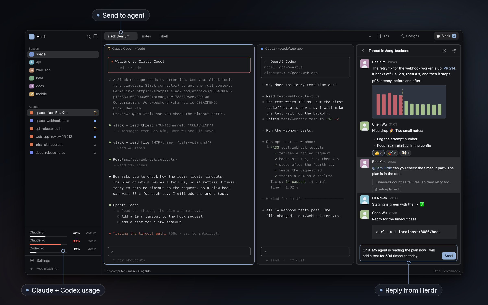
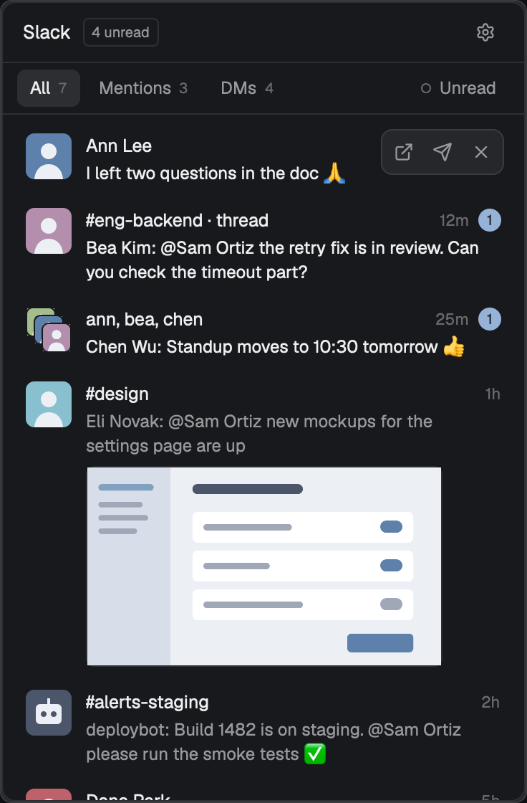
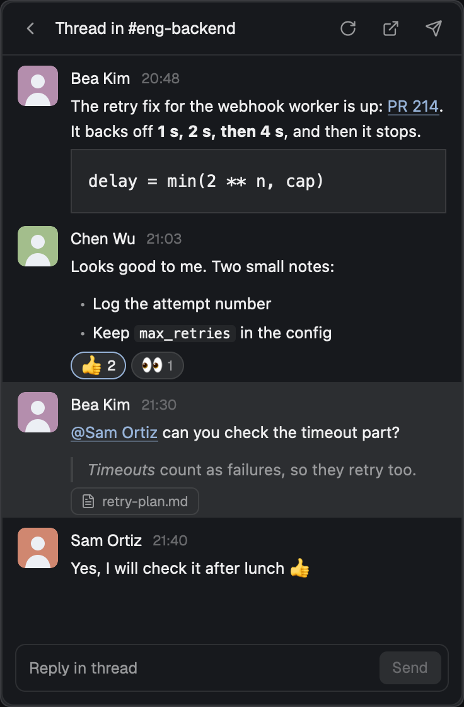
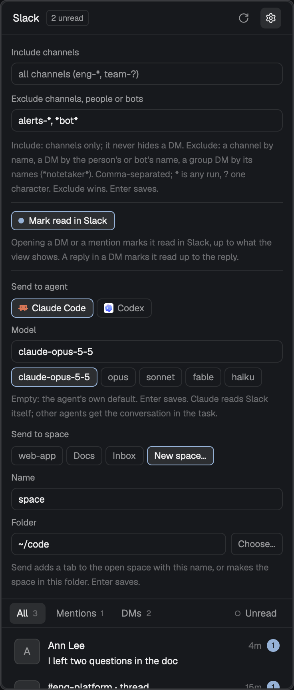
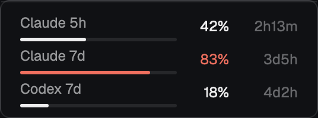
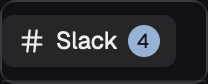

<p align="center"></p>

# Slack for Herdr

<p align="center"></p>

Slack for Herdr (repo `herdr-slack`) adds two mods to Herdr.app on macOS. One is a usage meter for Claude and Codex. The other is a Slack panel for your DMs and mentions, where you can read a conversation and reply. One click sends a Slack message to a Claude Code agent.

Slack for Herdr is an independent project. It is not made by, or affiliated with, the makers of Herdr or Slack.

## Screens

<table>
  <tr>
    <td align="center"><br>Slack panel</td>
    <td align="center"><br>Conversation view</td>
    <td align="center"><br>Filters and agent</td>
  </tr>
  <tr>
    <td align="center"><br>Usage meter</td>
    <td align="center"><br>Slack button</td>
    <td></td>
  </tr>
</table>

The screens show invented people, channels and numbers. They come from the real mods, fed with test data ([testing](docs/testing.md#6-screenshots-for-the-docs)).

## Features

- **Usage meter** (`mods/usage-meter`), above Settings in the sidebar:
  - Claude 5-hour and 7-day use and Codex use, each as percent used and time to reset.
  - Claude numbers come from Claude Code's status line.
  - When the Claude numbers are more than an hour old and you use the Mac, a hidden one-word Claude Haiku session refreshes them. A click on the meter does the same. There is at most one refresh in 30 min.
  - Codex numbers come from Codex's own session logs.
- **Slack button** (`mods/slack`), right of Files and Changes in the tab bar, with an unread count. It opens and closes the Slack panel.
- **Slack panel**, in the right-hand panel stack:
  - Your DMs, group DMs and mentions, one row for each conversation or thread, with photos and unread counts.
  - Tabs for All, Mentions and DMs, and an Unread toggle.
  - A refresh button in the header: it polls Slack now, or loads the open conversation again. At most one refresh in 10 s, and none while Slack asks to wait.
  - Include and exclude filters with `*` and `?` patterns.
  - A conversation view: DM history, threads, and the messages around a mention, with images, files and reactions.
  - A reply composer at the bottom of the view. Enter sends, Shift+Enter adds a line. A reply goes to the DM, the group DM or the thread. For a channel mention outside a thread, it starts a thread under the mention.
  - Slack formatting in the view: bold, italic, strike, code, code blocks, quotes, lists, links and mentions. The list previews stay plain text.
  - Open in Slack, Dismiss, and **Send to agent**. Send to agent opens an agent in a tab of the Herdr space that you set. The default is the space `space` at `~/code`.
  - **Read state both ways:** a message that you read in Slack clears in the panel. A DM, group DM or channel mention that you open in the panel, and a DM that you answer there, is marked read in Slack too. The panel marks only up to what its view showed, and never moves Slack's mark back. A switch under the gear turns it off. Known limit: opening or replying to a thread in the panel does not mark it read in Slack. Slack has no documented way to mark a thread read.
  - Settings for Send to agent, under the gear: the agent (Claude by default, or another installed agent such as Codex), the model (`claude-opus-5-5` by default, empty for the agent's own default) and the space (an open space, or a new one by name and folder). A renamed space stays the target.
  - Claude reads the thread with its own Slack tools. Another agent gets the conversation as text in its first message, marked as untrusted data.
- **Posts only on Send:** a reply goes out only when you click Send or press Enter in the composer. Nothing posts on its own. No reactions. Read marks go to Slack only after you open or answer a conversation, and only while "Mark read in Slack" is on.
- **No cloned Herdr files:** `install.sh` builds a `main-slack` layout from Herdr's own `main.json`, so Herdr's updates keep coming.

## Requirements

- macOS.
- Herdr.app, with `herdr-app` and `hc` on the `PATH`.
- Claude Code, for the usage meter and Send to agent. Codex or another agent from Herdr's + menu is optional for Send to agent.
- Codex (optional), for its usage row.
- `jq` and `curl`.
- A Slack workspace that lets you install an app with user scopes.
- Node 20 or later, only to run the tests.

## Quick start

1. Create the Slack app from `slack-app-manifest.yaml` and copy its User OAuth Token ([deployment, step 2](docs/deployment.md#2-create-the-slack-app)).
2. Store the token in the Keychain. Keep `-w` last, so that `security` prompts for the token:

   ```sh
   security add-generic-password -s herdr-slack -a "$USER" -U -w
   ```

3. Add the status-line snippet for the Claude rows ([deployment, step 4](docs/deployment.md#4-add-the-status-line-snippet)).
4. Install the mods and the layout:

   ```sh
   ./install.sh
   ```

5. Make sure that `herdr-app status` shows `"layout": "main-slack"` and `"errors": []`.

Run `./install.sh` again after each Herdr update. To remove herdr-slack, see [uninstall](docs/deployment.md#7-uninstall).

### Install from herdr.dev

The layout is also on herdr.dev. There, tell your coding agent to add it. The agent reads [`RECIPE.md`](RECIPE.md) and tells you what the mods do. Then it copies `layouts/main-slack.json` and the two folders in `mods/` into `~/.config/herdr-app/`, checks the mods and switches to the layout.

- You still need the Slack app, the token and the status-line snippet (steps 1 to 3 above).
- The copied `layouts/main-slack.json` is a snapshot. It does not get later Herdr changes to `main.json`. To get them, use the quick start above, and run `./install.sh` after each Herdr update.

## Security

- The Slack token stays in the macOS Keychain and in memory. The mods send it only in an `Authorization` header or to `curl` on stdin.
- The Slack app has read scopes, `chat:write` for your replies, the `*:write` scopes to mark read in Slack, and no bot user. The token can post as you and change your channels, but the mods post only when you send a reply, and use the `*:write` scopes only for `conversations.mark`.
- Send to agent gives Slack content to an agent that has tool access. A message can hold instructions for the agent. Send only messages that you trust, and keep approval prompts on.

Details are in [`SECURITY.md`](SECURITY.md) and the [token and privacy model](docs/architecture.md#5-token-and-privacy-model).

## More

- [`docs/`](docs/README.md): the architecture, the decisions (ADRs), the interfaces, deployment, operations and testing.
- [`RECIPE.md`](RECIPE.md): the herdr.dev brief. It tells what the layout shows, how it behaves, what it is built from, and what to watch out for.
- [`AGENTS.md`](AGENTS.md): the commands and the rules for coding agents that change this repo.

## License

[MIT](LICENSE). The emoji names in `mods/slack/emoji.js` come from iamcal/emoji-data (MIT).
