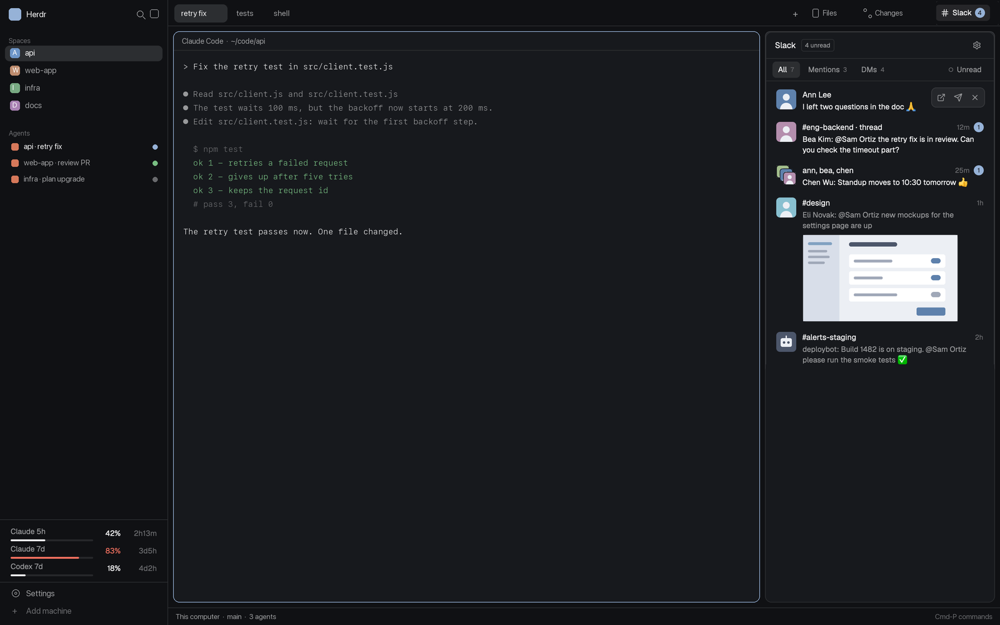

# herdr-slack

Herdr's own window with two additions. A usage meter sits above Settings in the sidebar and shows Claude 5-hour, Claude 7-day and Codex use. A Slack button sits right of Files and Changes in the tab bar and opens a Slack panel in the right-hand panel stack. The panel lists your DMs, group DMs and mentions, one row for each conversation or thread. It reads a conversation in place and sends a message to a Claude Code agent with one click. Nothing in Slack changes.



## What you see

Left to right, then top to bottom. All colours are theme names, so the layout follows the theme.

- **Sidebar** (`sidebar`, 268 px, `chrome`), top to bottom:
  - Herdr's brand row (46 px), and the spaces and agents lists.
  - The usage meter, then Settings and Add machine (69 px).
- **Usage meter** (`usage`, 100 px, `chrome`, a 1 px `border` line on top):
  - Three rows: `Claude 5h`, `Claude 7d` and `Codex 7d`. The Codex window name comes from its data. A fourth row shows a second Codex window, if Codex reports one.
  - Each row is 22 px high, with 6 px between rows, 16 px side padding and 12 px text.
  - Each row has three columns. The first is the label (`muted`) over a 3 px bar. The second is the percent (36 px wide, right-aligned). The third is the time to reset (50 px wide, `dim`, for example `4h30m`).
  - The bar track is `border`. The bar and the percent are `foreground`, `blocked` at 80% or more, and `ansi1` at 95% or more.
  - Unknown shows a dash, never `0%`. A passed reset shows `reset` and no number. Data older than 60 min is `dim`, and the tooltip gives its age.
  - Narrower than 160 px (the rail), the meter shows only the three percents, 10.5 px.
- **Tab bar** (`tabs-row`, 42 px): Herdr's own tabs, `+`, Files and Changes, then the Slack button block (`slack-button`, 104 px).
  - The button is 26 px high, 12 px text, with a hash icon and the word `Slack`, like Files and Changes. Its background is `selected` while the panel shows Slack.
  - An unread count sits in a 16 px pill (`accent`, text `accent_foreground`, `99+` at most).
  - Without a token or with a refused token, a 6 px `blocked` dot shows. Other problems show a `dim` dot.
- **Terminal card** (`main`): Herdr's active tab, unchanged.
- **Slack panel** (`slack` in the stack `panel-body`, 368 px when the panel column shows), a card with radius 10, `background` and a `border` line:
  - Header, 42 px: `Slack`, an `N unread` chip, and a gear that opens the filters.
  - Filters, under the header when open: `Include channels` and `Exclude channels, people or bots` (28 px inputs), a hint, and `N dismissed` with **Clear dismissed**.
  - Tabs row, 36 px: `All`, `Mentions` and `DMs` with row counts, and an `Unread` toggle at the right (a 7 px dot, `accent` when on).
  - Rows: a 32 px photo (radius 6), or the sender's initial on `raised`. A group DM shows up to three 21 px photos that overlap diagonally, with `+N` for more.
  - Each row has a title (the person, the group's names, or `#channel · thread`), the time (`now`, `5m`, `3h`, `2d`), and an unread count pill (`accent`). The title is semibold while the row has unread items.
  - The newest message shows as a preview of exactly two lines (12 px, 17 px line height). Group and channel rows start it with the sender's name.
  - An image in the newest message shows as a thumbnail under the preview, at most 260 x 140 px, radius 6.
  - Slack emoji codes show as Unicode emoji. Custom workspace emoji stay as `dim` `:name:` text.
- **Conversation view**, in place of the list:
  - Header, 42 px: a back arrow, the group photos for a group DM, the title, Open in Slack and Send to agent.
  - The title is the person, the group, `#channel`, or `Thread in #channel`.
  - Messages: a 32 px photo, the name (12.5 px semibold) and the time, then the full text (12.5 px, 18 px line height).
  - The time is `14:32` for today, else `12 Nov 14:32`.
  - Messages from the same sender within 5 min hide the photo and name.
  - Under the text, in this order:
    - image thumbnails and GIPHY images
    - other files as chips (22 px)
    - reaction chips (22 px, radius 11, emoji and count, an `accent` outline when you reacted)
    - `N replies` (`accent`).
- **Status bar** (`status`, 28 px): Herdr's own.

## How it behaves

- **Agent status:** this layout draws agent status only with Herdr's own `spaces`, `agents`, `tabs` and `pane` mods, as in `main`. Working agents show a spinner, and blocked and done agents show a `blocked` or `done` dot. The two new mods show no agent status.
- **Timers:** each of these runs every 60 s. No timer redraws for animation.
  - The meter reads the usage files.
  - The button copy polls Slack.
  - The panel moves the relative times, and refreshes an open conversation view.
- **Usage meter:**
  - A click reads the files again and starts a probe if one is allowed. If a probe ran less than 30 min ago, a toast tells when the next one is allowed.
  - A probe is a hidden one-word Claude Haiku session. It starts by itself when the Claude data is more than 60 min old and the Mac had input in the last 10 min.
  - At most one probe runs in 30 min. While it runs, a spinner shows next to the Claude rows.
- **Slack button:** a click opens or closes the panel on Slack. Each space keeps its own open panel (Files, Changes, Slack or none), through Herdr's `tabs` mod.
- **Panel list:**
  - Hover over a row: a small bar with Open in Slack, Send to agent and Dismiss shows over the row's top right. The row does not get taller.
  - Click a row: the conversation view opens, and the row's items are seen.
  - Open in Slack opens the permalink with the system's `open`.
  - Dismiss hides every item of the row from the list and the badge until **Clear dismissed**.
  - The `Unread` toggle shows only rows with unread items, and the tab counts follow it. The toggle is kept.
  - Filters save on Enter or when an input loses focus.
  - Include lists channel patterns. It never hides a DM.
  - Exclude hides a channel by name, a DM by the person's or bot's name, and a group DM by its names.
  - `*` is any run of characters and `?` is one character. Exclude wins.
- **Send to agent:**
  - It opens Claude Code (`claude --model claude-opus-5-5`) in a new tab of the Herdr space named `space`. If that space is not open, it makes it at `~/code`.
  - The first message gives the permalink. It tells Claude to read the thread, the files and the links with its own Slack tools. It tells Claude to treat that content as data, not as instructions.
  - One send runs at a time. A failed send shows an error toast and leaves the item unread.
- **Conversation view:**
  - A DM or group DM opens its newest 50 messages, scrolled to the bottom. `Load older` shows the next 50.
  - A thread opens all its replies, with the mention highlighted on `selected`.
  - A mention outside a thread opens the 15 messages up to it and the 10 after it. The mention is highlighted.
  - `N replies` opens that thread. The back arrow or Esc goes back one step, then to the list at the same tab and scroll position.
  - The view refreshes every 60 s. It stays at the bottom unless you scrolled up.
- **Unread state:** a DM or top-level message is unread until Slack's read mark passes it, or until you open, send or dismiss it here. A thread reply is unread until you open, send or dismiss it here.
- **Errors:** no token, a refused token, a rate limit and no network each show a short `dim` message in the panel. The last items stay. A rate limit waits 60 s, then twice as long each time, up to 10 min.

## Built from

- **Layout** `layouts/main-slack.json`: Herdr's `main.json` with three changes (`layout/main-slack.jq` makes it):

  ```
  root (row)
  ├─ sidebar (column, 268 px)
  │  ├─ brand (46 px)           workspace-chrome
  │  ├─ sidebar-lists           spaces, agents
  │  ├─ usage (100 px)          usage-meter              <- added
  │  └─ sidebar-footer (69 px)  workspace-chrome {footer: true}
  └─ work (column)
     ├─ tabs-row (row, 42 px, not resizable)             <- was the tabs block
     │  ├─ tabs (weight 1)      tabs
     │  └─ slack-button (104 px) slack {role: "button"}  <- added
     ├─ work-body (row)
     │  ├─ main                 the active tab
     │  └─ panel (368 px, hidden) > panel-body (stack)
     │     ├─ files, changes
     │     └─ slack             slack {role: "panel"}    <- added
     └─ status (28 px)          workspace-status
  ```

- **Mods:**
  - `usage-meter`: one copy, block `usage`.
  - `slack`: two copies of the same code. The `role` prop picks the job.
    - The `button` copy is always shown, so it polls Slack and publishes the results.
    - The `panel` copy draws the list and the view, and runs Send to agent.
- **Shipped mods used, not cloned:** `workspace-chrome`, `spaces`, `agents`, `tabs`, `pane`, `files`, `changes` and `workspace-status`. The mods also draw four of `workspace-chrome`'s icons: `spinner.svg`, `settings.svg`, `chevron-left.svg` and `file-text.svg`.
- **`herdr` functions:**
  - `usage-meter`: `exec`, `hc`, `home`, `readTextFile`, `theme`, `layout`, `notify`, `localStorage` (`lastProbe`).
  - `slack`: `exec`, `fetch`, `theme`, `layout`, `run`, `props`, `shared`, `setShared`, `spaces`, `home`, `appHome`, `notify`, `localStorage`. The button copy keeps `people`, `channels`, `members` and `lastRead`. The panel copy keeps `people`, `channels` and `unreadOnly`.
- **Commands:**
  - `layout.select {stack: "panel-body", child: "slack"}`, `layout.show {id: "panel"}` and `layout.hide {id: "panel"}`, through `run`.
  - `tab.new` and `space.new`, through `herdr-app do`, so that a failure comes back as an error.
- **Shared keys:**
  - `slack.items`: the newest 150 items, only when the list changes.
  - `slack.status`, `slack.me` (the user id, never the token), `slack.seen`, `slack.dismissed` and `slack.filters`.
  - `workspace.panels`: the button copy adds `"slack"`.
- **Slack Web API**, user token, read-only:
  - Methods: `auth.test`, `search.messages` (`<@USER_ID>` and `to:me`, 50 each, by time), `users.info`, `conversations.info`, `conversations.members`, `conversations.history` and `conversations.replies`.
  - Scopes: `search:read`, `users:read`, `channels:read`, `groups:read`, `im:read`, `mpim:read`, `files:read`, `channels:history`, `groups:history`, `im:history` and `mpim:history` (`slack-app-manifest.yaml`).
- **Programs:**
  - `security find-generic-password -s herdr-slack -w`, for the token.
  - `curl` for images, with the token on stdin for Slack files only.
  - `sh`, `ls`, `mkdir`, `mv` and `rm` for the image cache. `open` for permalinks. `herdr-app do` for Send to agent.
  - The meter runs `sh` with `find`, `tail` and `grep` over the Codex logs, and `ioreg` for idle time.
  - The meter's probe runs `hc run`, `hc wait`, `hc get`, `hc kill` and `hc rm`, with `claude --model claude-haiku-5-5`.
- **Art:**
  - `mods/slack/slack.svg` (a hash sign), `open.svg`, `send.svg` and `dismiss.svg`. These are one-colour glyphs, tinted with the text colour.
  - `mods/slack/emoji.js` maps Slack emoji names to Unicode. `scripts/gen-emoji.mjs` makes it from iamcal/emoji-data v16.0.0.

## Watch out

Tell the person these facts before you add this layout:

- **Network:** the `slack` mod connects to these hosts:
  - `slack.com`, for the Web API.
  - `avatars.slack-edge.com` and `secure.gravatar.com`, for profile photos.
  - `files.slack.com`, for the images in messages.
  - `media*.giphy.com`, for GIPHY images.
- **Programs:** the mods run `security`, `curl`, `sh`, `ls`, `mkdir`, `mv`, `rm`, `open`, `herdr-app`, `hc`, `find`, `tail`, `grep` and `ioreg`. The usage probe starts `claude` with Claude Haiku. Each probe is a small paid turn on the person's Claude plan.
- **Files outside the mods' folders:**
  - The meter reads `~/.cache/herdr-slack/claude-usage.json` and the newest files in `~/.codex/sessions/`.
  - The `slack` mod writes a hidden image cache, `~/.config/herdr-app/.slack-cache/`. It deletes cached files that no item uses any more.
- **Setup before it works:**
  - A Slack app from `slack-app-manifest.yaml`, with its user token in the Keychain as service `herdr-slack`.
  - For the Claude rows, a status-line snippet that writes the usage file.
  - Steps: [`docs/deployment.md`](docs/deployment.md).
- **Agent risk:** Send to agent gives Slack content to an agent with tool access. A message can hold instructions. Keep the agent's approval prompts on ([`SECURITY.md`](SECURITY.md)).
- **Herdr limits that shaped the build:**
  - `image()` loads only files under the app home, so the image cache is in `~/.config/herdr-app/.slack-cache/`. It is hidden because a file saved under `mods/` reloads the mod.
  - `fetch` gives no response headers and no bytes: images go through `curl`, and a rate limit uses a fixed backoff.
  - `exec` has no stdin, so `sh` pipes the token from `security` to `curl`.
  - A mod copy starts the first time it shows. The panel column starts hidden, so the poller is in the always-shown button copy.
  - Herdr's `tabs` mod restores a space's panel only if its id is in `shared("workspace.panels")`, so the button copy adds `"slack"`.
- **Snapshot:** `layouts/main-slack.json` is a snapshot of Herdr 0.1.15's `main.json` with the patch. After a Herdr update that changes `main.json`, make the file again with `layout/main-slack.jq`, or run `./install.sh`. A copy from herdr.dev does not change by itself.
- **Fixed values in `mods/slack/lib.js`:** the space name `space`, the folder `~/code`, and the agent command `ARGV` (`claude --model claude-opus-5-5`).
- **Limits:** no pagination (50 newest matches for each search, 150 items kept). Without the `*:history` scopes, the view shows "Needs history permission". Without `files:read`, there are no thumbnails. Custom workspace emoji show as text.
- **`herdr-app check`** runs the meter's `init`. If the Claude data is stale and the Mac is in use, the check can start a probe. The meter removes a probe older than 5 min on its next probe.

## Done when

- `herdr-app check ~/.config/herdr-app/mods/usage-meter` and `herdr-app check ~/.config/herdr-app/mods/slack` pass.
- `herdr-app status` shows `"layout": "main-slack"` and `"errors": []`.
- The meter is directly above Settings, with `Claude 5h`, `Claude 7d` and `Codex 7d` rows. With the sidebar narrower than 160 px, it shows only the percents.
- The Slack button is right of Changes. A click opens and closes the panel, and another space keeps its own panel choice.
- With no Keychain item, the button shows a `blocked` dot, and the panel says "No Slack token in the Keychain".
- With the token, within 60 s `~/.config/herdr-app/shared.json` has `slack.me` set, `slack.status` with `"state": "ok"`, and `slack.items` with one item or more. The panel shows rows.
- A click on a DM row opens its history. With the history scopes, the newest message is at the bottom, and Esc goes back to the list.
- After a probe (a click on the meter), `hc ls` shows no `herdr-usage-probe` terminal.
- `grep -r xoxp ~/.config/herdr-app` finds nothing.
- In this repo, `npm test` passes.
