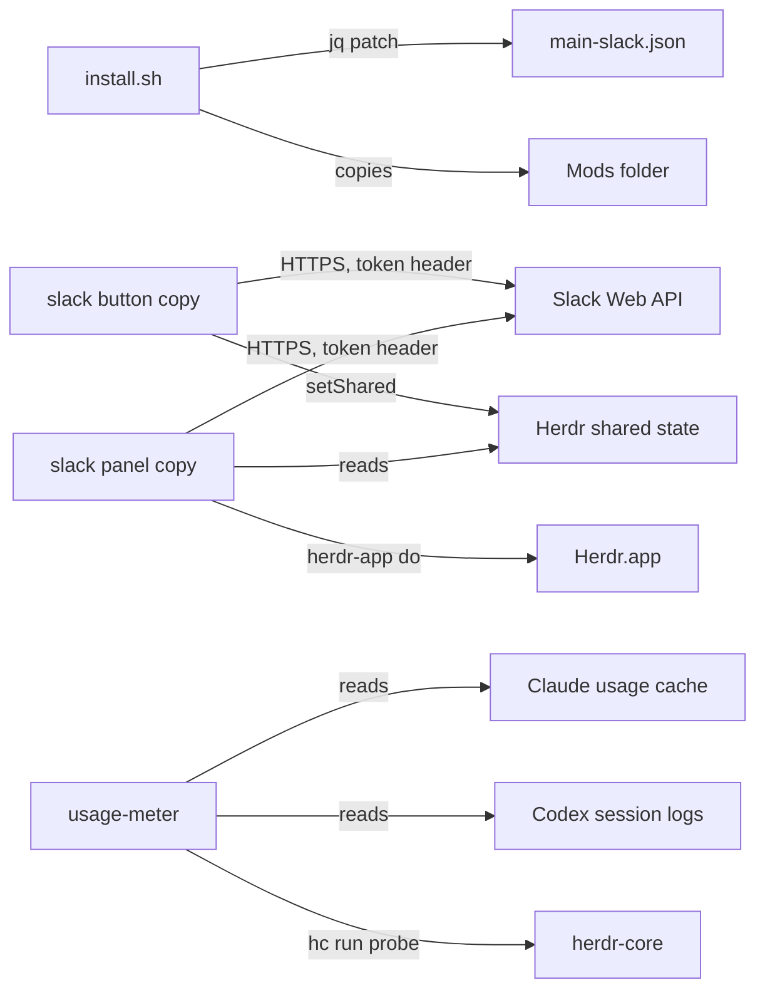
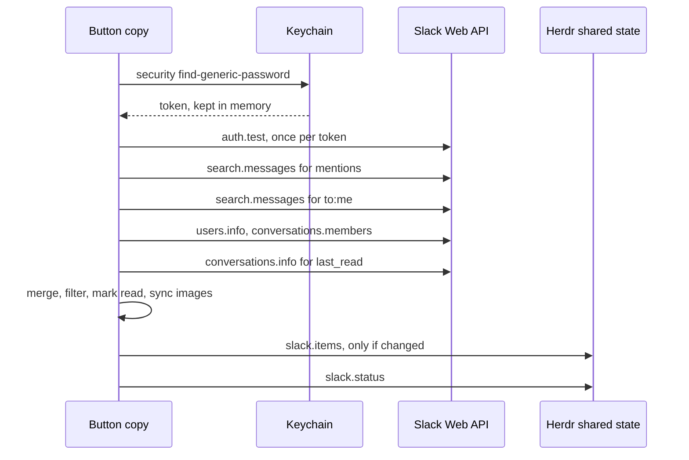
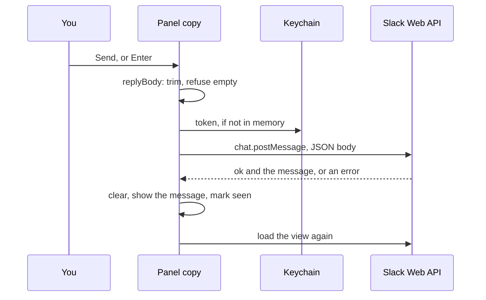
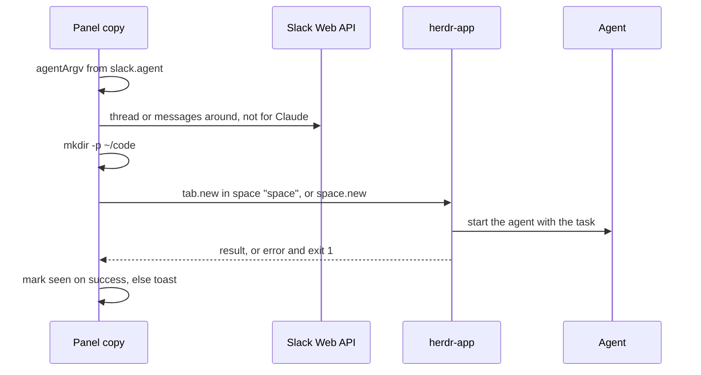
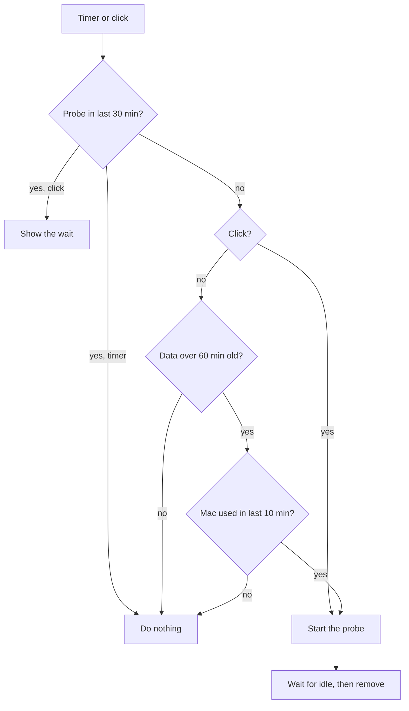

# Architecture

herdr-slack adds two mods and one generated layout to Herdr.app on one Mac. The mods run inside Herdr.app as JavaScript. There is no server, daemon or database.

- **Status:** as built on `main`, 2026-11-15.
- **Decisions:** each design choice has an ADR in [`adr/`](README.md#decisions-adr).
- **Related:** [interfaces](interfaces.md), [deployment](deployment.md), [operations](operations.md).

## 1. Components

This diagram shows the parts and the calls between them.

| Component                | Source                            | Runs as                                                  | Job                                                                                                     |
| ------------------------ | --------------------------------- | -------------------------------------------------------- | ------------------------------------------------------------------------------------------------------- |
| `usage-meter` mod        | `mods/usage-meter/`               | Block `usage` above Settings in the sidebar              | Shows Claude 5h, Claude 7d and Codex use. Starts a Haiku probe when the Claude data is stale.           |
| `slack` mod, button copy | `mods/slack/`, `role: "button"`   | Block `slack-button` right of Files and Changes          | Polls Slack each minute, publishes the items, draws the button and the unread badge.                    |
| `slack` mod, panel copy  | `mods/slack/`, `role: "panel"`    | Block `slack` in the right-hand panel stack `panel-body` | Draws the list, the filters, the conversation view and the composer. Posts replies. Runs Send to agent. |
| Layout patch             | `layout/main-slack.jq`            | `jq`, from `install.sh`                                  | Builds `main-slack.json` from Herdr's own `main.json`.                                                  |
| Installer                | `install.sh`                      | Shell, by hand                                           | Copies the mods, builds the layout, checks the mods and switches to `main-slack`.                       |
| Slack app manifest       | `slack-app-manifest.yaml`         | Pasted into api.slack.com                                | Makes a Slack app with read user scopes, `chat:write` and no bot user.                                  |
| Emoji map                | `mods/slack/emoji.js` (generated) | Built by `scripts/gen-emoji.mjs`                         | Maps Slack `:short_name:` codes to Unicode.                                                             |

- Both copies of the `slack` mod run the same `main.js`. The `role` prop picks the job.
- Pure logic is in `lib.js` in each mod. It imports nothing from Herdr, so `node --test` runs it ([testing](testing.md)).

## 2. Layout

`install.sh` runs `layout/main-slack.jq` on `~/.config/herdr-app/layouts/main.json` and writes `layouts/main-slack.json` ([ADR 0001](adr/0001-generate-layout.md)). The patch makes three changes:

1. It adds block `usage` (100 px, `usage-meter`) before `sidebar-footer`, so the meter sits directly above Settings.
2. It replaces block `tabs` with row `tabs-row`: Herdr's own `tabs` block, then block `slack-button` (104 px, `slack` with `role: "button"`).
3. It adds block `slack` (`slack` with `role: "panel"`) to the stack `panel-body`, next to `files` and `changes`.

- If `main.json` has no node `sidebar-footer`, `tabs` or `panel-body`, `jq` stops with an error and the old `main-slack.json` stays.
- No shipped mod is cloned. The Slack button is its own block ([ADR 0002](adr/0002-no-cloned-mods.md)).
- The button copy adds `"slack"` to the shared list `workspace.panels`. Herdr's `tabs` mod restores a space's open panel only if its id is in that list.

## 3. Slack data flow

### 3.1 Poll

The button copy is always shown, so it runs the poller ([ADR 0003](adr/0003-poller-in-button.md)). The panel copy starts only when the panel first opens, and it only reads what the poller publishes.

This diagram shows one poll. It runs at start and then every 60 s.

- Two searches cover all items: `<@USER_ID>` for mentions and `to:me` for DMs and group DMs ([ADR 0004](adr/0004-two-searches.md)).
- Each search asks for the newest 50 matches by time. There is no pagination.
- The poller merges the matches with the old list, removes duplicates by channel id and `ts`, applies the filters, and keeps the newest 150 items.
- Each preview is at most 300 characters.
- Lookups have caps for each poll: 10 new people, 10 group DM member lists, 10 channel names and 10 `last_read` values.
- Only one poll runs at a time.

### 3.2 Shared state

Every copy of every mod can read these keys. Herdr keeps them in `~/.config/herdr-app/shared.json`. A `setShared` call draws every mod again, so the poller writes a key only when its value changed.

| Key                | Written by            | Content                                                                                       |
| ------------------ | --------------------- | --------------------------------------------------------------------------------------------- |
| `slack.items`      | Button copy           | Up to 150 items: ids, conversation, sender, preview, permalink, read flag, image references.  |
| `slack.status`     | Button copy           | `{state, message}`. `state` is `ok`, `no-token`, `auth`, `ratelimited`, `network` or `error`. |
| `slack.me`         | Button copy           | The user id of the token, from `auth.test`.                                                   |
| `slack.seen`       | Panel copy            | Ids of items opened, sent or dismissed in the panel. Pruned to the listed items.              |
| `slack.dismissed`  | Panel copy            | Ids of dismissed items. Pruned to the listed items.                                           |
| `slack.filters`    | Panel copy            | `{include, exclude}` pattern lists.                                                           |
| `slack.agent`      | Panel copy            | `{agent, model}` for Send to agent. `agent` is a `knownAgents()` key.                         |
| `workspace.panels` | Herdr, plus `"slack"` | The panel ids that Herdr's `tabs` mod restores for each space.                                |

### 3.3 Storage for each copy

Each mod copy has its own `localStorage`. Herdr keeps it under `~/.config/herdr-app/data/<mod>/`.

| Copy        | Key          | Content                                                      |
| ----------- | ------------ | ------------------------------------------------------------ |
| Button      | `lastRead`   | Channel id to `last_read` ts, pruned to the listed items.    |
| Button      | `people`     | User id to display name, real name, handle and avatar URL.   |
| Button      | `channels`   | Channel id to name, for mentions written as `<#C123>`.       |
| Button      | `members`    | Group DM id to member ids.                                   |
| Panel       | `people`     | The same shape, for senders in the conversation view.        |
| Panel       | `channels`   | The same shape, for channels named in the conversation view. |
| Panel       | `unreadOnly` | `"1"` when the Unread toggle is on.                          |
| Usage meter | `lastProbe`  | The time of the last probe, in ms.                           |

### 3.4 Image cache

Herdr's `image()` reads only from the app home, and a file saved under `mods/` reloads the mod. So the images go into a hidden folder in the app home, `~/.config/herdr-app/.slack-cache/`.

| Folder                                     | Content                                                    | Token    |
| ------------------------------------------ | ---------------------------------------------------------- | -------- |
| `avatars/`                                 | Profile pictures from `users.info`, and bot icons.         | No       |
| `files/`                                   | Thumbnails of images in messages (`thumb_360` or nearest). | Yes      |
| `media/`                                   | Public images in messages, such as GIPHY GIFs.             | No       |
| `view/avatars`, `view/files`, `view/media` | The same kinds, for the open conversation view.            | As above |

- Each poll deletes the files that no item uses, and gets at most 10 missing files. The conversation view gets at most 20.
- A file is kept only if Slack sent an `image/*` content type. A missing scope sends HTML, which the mod deletes.
- A failed download waits at least 10 min before the next try.
- Public downloads are capped at 8 MB.

### 3.5 Unread state

The panel never marks messages read and never adds reactions ([ADR 0006](adr/0006-read-only-unread.md)). Its only write is a reply that you send ([3.7](#37-replies)).

- A DM message or a top-level channel message is read when its `ts` is at or before the conversation's `last_read` from `conversations.info`.
- A thread reply does not move `last_read`. It stays unread until you open it, send it or dismiss it in the panel.
- An item is unread when it is not read and its id is not in `slack.seen`.
- The badge on the button counts unread messages that pass the filters and are not dismissed.

### 3.6 Grouping and the conversation view

The list shows one row for each conversation or thread, as in Slack's activity view ([ADR 0010](adr/0010-grouping-and-conversation-view.md)).

- A DM or group DM is one row for each conversation.
- A channel mention is one row for each thread. A mention outside a thread is its own row.
- Tabs (All, Mentions, DMs) and the Unread toggle work on rows.

A click on a row opens a conversation view in the panel copy:

| Row kind                   | View                                                          | Slack method            |
| -------------------------- | ------------------------------------------------------------- | ----------------------- |
| DM or group DM             | The newest 50 messages, then Load older                       | `conversations.history` |
| Channel thread             | The thread, up to 5 pages of 200                              | `conversations.replies` |
| Channel mention, no thread | 15 messages up to the mention and 10 after it, mention marked | `conversations.history` |

- "N replies" under a message opens that thread on top of the view. Back or Esc closes it.
- The view shows Slack formatting. `mrkdwn()` in `lib.js` turns the message text into CommonMark, and `TextView.markdown` draws it:
  - bold, italic, strike and code
  - code blocks, quotes, and bullet and numbered lines
  - links, which open with `open` on `http`, `https` and `mailto` only
  - mentions, as links to the person or channel in Slack.
- The list previews stay plain text. `plain()` removes the formatting marks.

### 3.7 Replies

The conversation view has a composer at the bottom ([ADR 0011](adr/0011-replies-from-the-conversation-view.md)). A reply posts in Slack as you.

| View                             | Reply goes to                            | `thread_ts`                  | Placeholder                  |
| -------------------------------- | ---------------------------------------- | ---------------------------- | ---------------------------- |
| DM                               | The conversation                         | None                         | `Reply to Ann Lee`           |
| Group DM                         | The conversation                         | None                         | `Message ann, bea, chen`     |
| Thread                           | The thread                               | The root `ts`                | `Reply in thread`            |
| Channel mention outside a thread | A new thread under the mentioned message | The mentioned message's `ts` | `Reply in thread to Bea Kim` |

This diagram shows one reply.

- `replyTarget()`, `replyBody()`, `postReply()` and `replyError()` in `lib.js` hold the logic. `postReply()` gets `fetch` as an argument, so the tests use a stub.
- Enter sends and Shift+Enter adds a line. The panel binds both keys with `cx.bind_keys` in the key context `SlackReply > Input`, so they apply only in the composer.
- Esc with an empty composer leaves the view. With text in the composer, the first Esc only takes the focus off the composer.
- One post runs at a time. While it runs, Send and Enter do nothing.
- A failed post keeps the text and shows one line over the composer. Nothing retries it.
- A successful post clears the composer, adds the message to the view at once, marks the row seen and loads the view again. A reply under a mention outside a thread opens that thread.
- Each target has its own composer and draft, in the panel copy's memory. A mention's view and its thread share one. Back releases a composer only when it is empty.
- An open view loads again every 60 s.
- The messages of the view stay in the panel copy's memory. They never go into `shared`.

### 3.8 Send to agent

Send to agent hands one item to a new agent session. The agent and the model come from the settings ([ADR 0012](adr/0012-agent-and-model-settings.md)).

This diagram shows one send.

- Only one send runs at a time.
- The settings are in `shared("slack.agent")`, `{agent, model}`. The gear opens them, under the filters:
  - the agent: a chip for each installed agent from `knownAgents()`, Claude by default
  - the model: a text field with suggestions. Empty means the agent's own default.
- `agentArgv()` builds the argv from the agent's own `run` argv and its model flag: `--model` for Claude, `-m` for Codex, none for other agents. It refuses an agent that is not installed and a model with other characters than letters, digits, `.`, `-`, `_` and `/`.
- The space name `space` and the folder `~/code` are constants in `mods/slack/lib.js`. So are the defaults `AGENT` and the suggestions `MODELS`.
- The task for Claude holds the permalink, the channel id and name, `ts`, `thread_ts`, the sender and the preview. Claude reads Slack with its own connector.
- The task for another agent holds the same lines and the conversation itself:
  - The panel fetches it as the view does: the thread, else the 15 messages up to the item and the 10 after it.
  - `contextText()` writes each message as plain text: the sender, the time, the text with link URLs, the file names and the permalink.
  - The text is at most about 20,000 characters. The newest messages stay, and a line tells how many older ones were cut.
  - It sits between `BEGIN SLACK DATA` and `END SLACK DATA`. A line in the data that copies a marker becomes `END SLACK-DATA`.
  - If the fetch fails, the data block says why, and the preview stays in the task.
- The task never holds the token. It tells the agent to treat all Slack content as data, not instructions ([SECURITY.md](../SECURITY.md)).

### 3.9 Errors

Every failure keeps the last items on screen. The status says why.

| `slack.status` state | Cause                                                        | What the poller does                                         |
| -------------------- | ------------------------------------------------------------ | ------------------------------------------------------------ |
| `no-token`           | No Keychain item `herdr-slack`.                              | Reads the Keychain again on the next poll.                   |
| `auth`               | `invalid_auth`, `token_revoked`, `missing_scope` and others. | Forgets the token and reads the Keychain again next poll.    |
| `ratelimited`        | HTTP 429 or `error: ratelimited`.                            | Waits 1 min, then doubles up to 10 min. A success resets it. |
| `network`            | No connection or a body that is not JSON.                    | Tries again next minute.                                     |
| `error`              | Any other `ok: false`.                                       | Tries again next minute.                                     |

## 4. Usage meter

The meter reads two sources every 60 s and shows each window as percent used and time to reset.

- **Claude:** Claude Code gives its rate limits only to the status-line command. A line in your status-line script writes them to `~/.cache/herdr-slack/claude-usage.json` ([deployment](deployment.md#4-add-the-status-line-snippet)).
- **Codex:** the newest `token_count` event with `rate_limits` in the three newest Codex session logs of the last 8 days ([ADR 0008](adr/0008-codex-usage-from-logs.md)).

When the Claude data is old, the meter starts a short Haiku session to refresh it ([ADR 0007](adr/0007-haiku-usage-probe.md)). This diagram shows the decision.

- The probe is a hidden `hc run` terminal named `herdr-usage-probe`. It has no `herdr.space` label, so it never shows as a tab.
- The meter waits up to 120 s for the probe to go idle, then runs `hc kill` and `hc rm`.
- A probe that is older than 5 min is a missed cleanup. The next probe removes it first.

Display rules:

- An unknown value shows a dash, never `0%`.
- A window whose reset time has passed shows `reset` and no number until new data arrives.
- Data that is older than 60 min is dimmed. Its age is in the tooltip.
- A bar turns to the warning color at 80% and to red at 95%.
- When the sidebar is narrower than 160 px, the meter shows only the percentages.

## 5. Token and privacy model

### 5.1 The token

The Slack token is a user token with read scopes and `chat:write` ([ADR 0005](adr/0005-token-in-keychain.md), [ADR 0011](adr/0011-replies-from-the-conversation-view.md)). It can post as you. The mods post only on an explicit Send.

- It lives in the macOS Keychain, as a generic password with service `herdr-slack`.
- Each copy of the `slack` mod reads it with `security find-generic-password -s herdr-slack -w` and keeps it in instance memory only.
- API calls send it only in an `Authorization: Bearer` header through `fetch`.
- File thumbnails need the token. A shell pipe gives it to `curl` as a config file on stdin (`curl -K -`), so it never goes into argv.
- It never goes into argv, `shared`, `localStorage`, a file, a log, the agent task or the repo.
- Public images (avatars, GIPHY) are downloaded without it.

### 5.2 Data on disk

| Place                                    | Content                                                  | Lifetime                                                                             |
| ---------------------------------------- | -------------------------------------------------------- | ------------------------------------------------------------------------------------ |
| `~/.config/herdr-app/shared.json`        | `slack.*` keys: item previews, names, permalinks, ids.   | Until the items leave the newest 150.                                                |
| `~/.config/herdr-app/data/slack/`        | Names, avatar URLs, `last_read`, channel names, members. | Kept, and pruned for `lastRead`.                                                     |
| `~/.config/herdr-app/.slack-cache/`      | Avatars, message thumbnails and public media.            | Deleted when no item or open view uses it.                                           |
| `~/.cache/herdr-slack/claude-usage.json` | Claude usage percentages and reset times.                | Overwritten by each status-line draw.                                                |
| Panel copy memory                        | Messages of the conversation view, and reply drafts.     | Until the view closes or Herdr quits. A draft stays until it is sent or Herdr quits. |

### 5.3 What leaves the Mac

- Calls to the Slack Web API, with the token. A reply that you send goes to Slack as a post.
- Downloads of avatars and public media from their own hosts, without the token.
- Send to agent: the task text goes to the agent, which sends it to its model provider. Claude then reads Slack with its own connector. Another agent gets up to about 20,000 characters of the conversation in the task.
- The usage probe: a one-word prompt to Claude Haiku.

### 5.4 Trust

- Herdr mods are trusted JavaScript. They have command and network access.
- Processes that run as the same macOS user are trusted. They can read `shared.json` and the cache, and they can ask the Keychain for the token.
- Slack content is not trusted. The mod shows it as text, and Send to agent tells Claude that it is data. See [SECURITY.md](../SECURITY.md) for the prompt injection risk.
